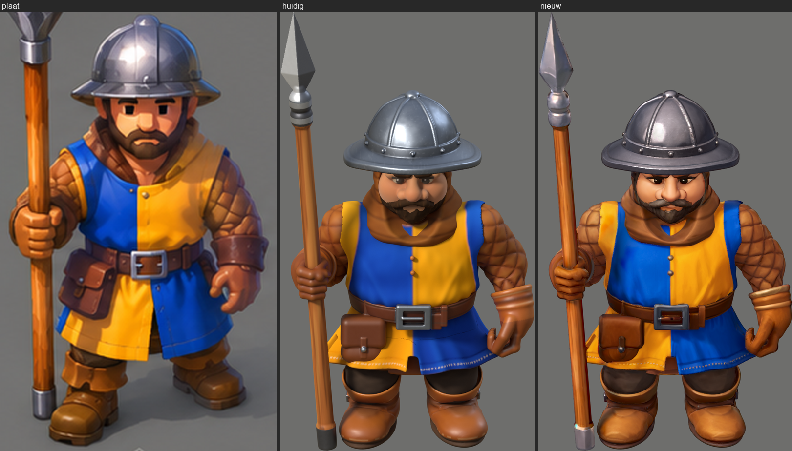
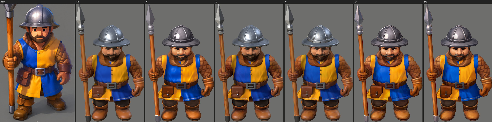
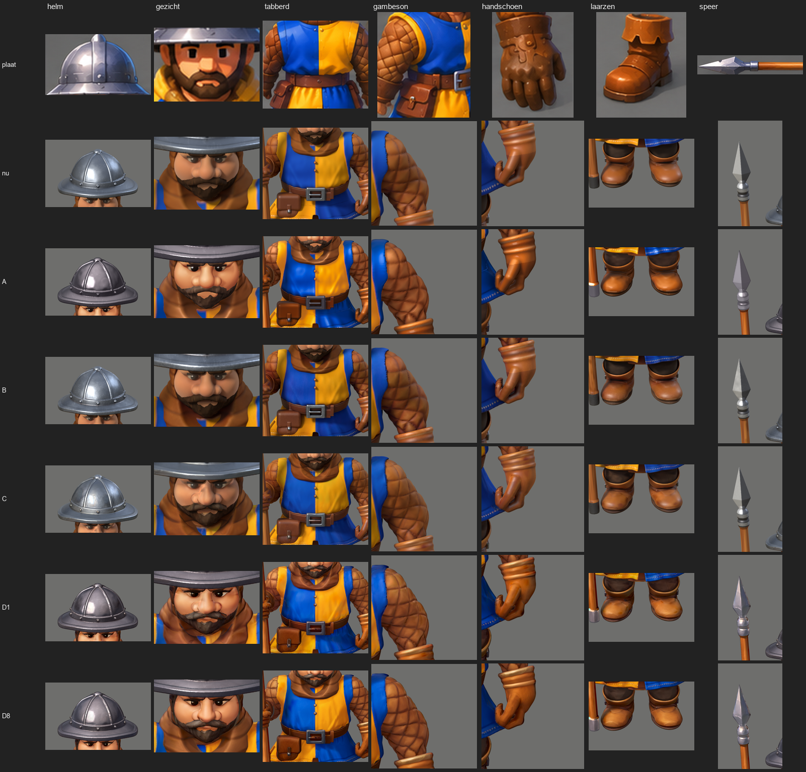
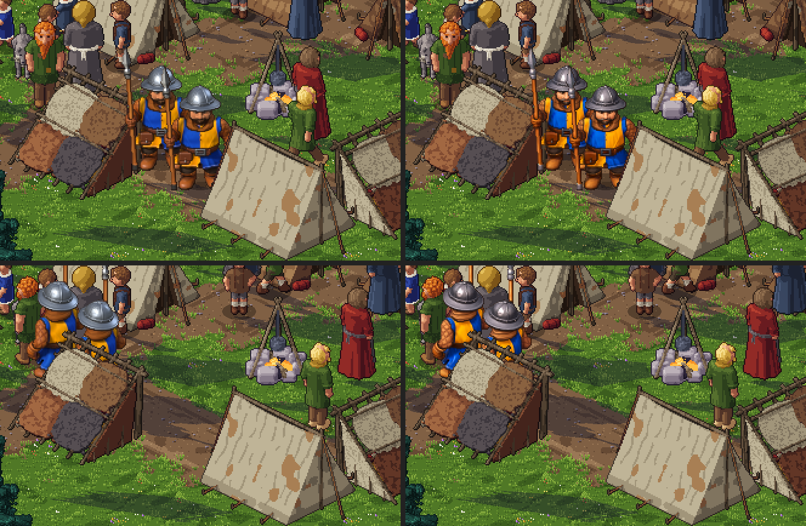
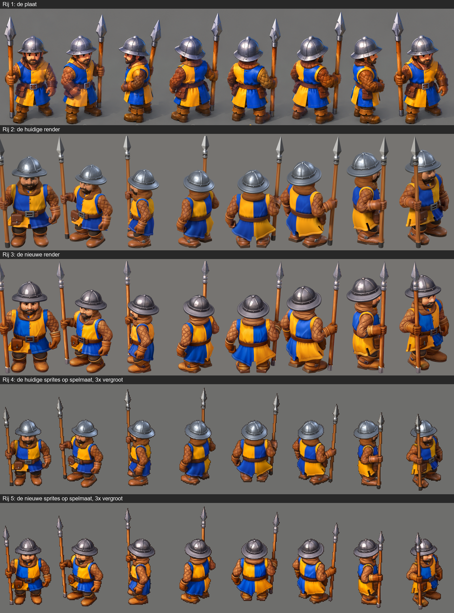

# De methodeproef: van 3D-reconstructie naar game-art

Vraag 192, 31 okt 2026, op de speerman in richting Z en daarna op alle acht de richtingen. **Dit is een proef:** de productie is niet veranderd, er is niets
gecommit en het spel heeft nog zijn eigen vellen. Het artistieke oordeel is aan Marcel.

## De conclusie vooraf

- **Beste methode: D8.** Dat is geschilderde verf op de UV, een geschilderd licht per pixel, en een AI-laag per richting op de UV. Hij staat zichtbaar dichter
  bij de plaat dan de huidige render, in materiaal en in licht. Op 80 pixels is de winst kleiner, maar wel te zien.
- **De plaat is nog niet bereikt.** Het grootste verschil dat overblijft, is de vorm, en die was in deze proef bewust gelijk. Een render-, verf- of AI-techniek lost
  dat niet op.
- **De rijkdom van de plaat zit vooral in het licht, niet in het oppervlak.** Daarom gaf textuur alleen (B) en een AI-beeld terugleggen op de verf (C) bijna niets, en het
  geschilderde licht (A) de grootste sprong van de losse methoden.
- **Volgorde:** eerst een vormronde op het model, dan D8. Elke modelwijziging vraagt nieuwe AI-lagen, zo'n 40 minuten per eenheid.

## 1. De oorzaken

Gemeten op richting Z, 330 pixels, plaat tegen de huidige render (`oorzaak2.py`, `bewijs/methoden/meting-schaal.json`). De kolom "wat het oplost" is de uitkomst van de proeven.

| Vraag | Plaat tegen huidig | Oorzaak | Wat het oplost |
|---|---|---|---|
| Vormtaal | Groter gezicht, tabberd over de schouders met kraag, grotere ruiten, wijde stand, handschoenkap, grotere buidels | Een ander model en een lagere camera | **Alleen geometrie** |
| Licht en donker | Onder L 25: 30,2 % tegen 22,2 % | Fysiek licht vult de schaduw op | **Shader** (geschilderd licht) |
| Kleur binnen een materiaal | Spreiding van de tint: blauw 4,4 tegen 2,4; geel 5,6 tegen 2,6. Geel van schaduw naar licht: 11,7° tegen 0,6° | Eén verfkleur maal licht verschuift de tint niet | **Shader** (kleurverloop per soort), plus textuur en AI |
| Vorm van de hoogste lichten | Blauw L99 boven het midden: 23,4 tegen 15,7 | Vlakke stof vangt geen vormlicht | **Shader**. Op blauw nog niet opgelost: D8 15,7 |
| Lokale schaduw | Geel L1 onder het midden: 17,2 tegen 11,5 | Holten en lagen lezen te zacht | **Gebakken AO** en een contactlijn uit de diepte |
| Detail per schaal | Blauw .89/1.31/1.86/2.14 tegen .46/.92/1.32/1.62 | Te weinig middelgrote toon | **Shader en AI**, samen |
| Schilderachtige afwerking | Niet te meten; op het oog groot | De streek en de keuzes van een schilder ontbreken | **AI-stap** of een schilder |
| Contour en silhouet | Plaat gedrongener, schouders en handen zwaarder | Model | **Geometrie**, en de lijnen in `vel.py` |
| Geometrie tegen geschilderd detail | Verf alleen (B) verandert weinig | Details kleiner dan een pixel op 80 | Grote vormen in **geometrie**, de rest in licht |
| Verkleining | Niet de oorzaak (vorige ronde) | Op 80 pixels telt alleen detail vanaf zo'n 4 pixels op 330 | Fijn detail overdrijven of weglaten |

## 2. De huidige techniek

Eén shader (`materialen.py`) met per materiaal een recept (`materialen.json`), de verf op de punten van de mesh, Cycles met één lichtopstelling (`licht.py`, 64 monsters, 768 pixels), en daarna
`vel.py`: verkleinen met BOX, scherpte, kleur, ID-lijnen, rand en harde alfa, met een vast anker. Het licht en de kleur worden dus samen uitgerekend, en de render laat zien wat dat fysiek geeft. De plaat
werkt andersom: die kiest per plek de kleur van het licht en de schaduw.

## 3. De vier methoden

Alles met dezelfde geometrie, pose, camera, schaal, achtergrond en export. De zon staat bij A, D1 en D8 meer opzij: dat kost daar geen kleur, omdat de kleur uit het verloop komt.

| Methode | Wat het is | Oordeel op het oog |
|---|---|---|
| **A, gestileerd licht** | `verlicht.py`: een G-buffer uit Cycles, daarna per pixel overdreven normalen, zachte banden, een contactlijn, een randlicht, per materiaalsoort een kleurverloop uit de plaat, en staal via een geschilderde omgeving. Geen ruis. | Duidelijk meer vorm en diepte. Nog glad. De grootste winst van de losse methoden. |
| **B, geschilderde verf** | `schilder.py`: lagen op de UV met een reden (drift, streek, slijtage op bolle randen, vuil onderaan, roest, nerf, AO) | Variatie en AO, maar in productielicht weinig verschil, ook op 80 pixels. **Geen handwerk:** er was geen schilder in de lus. |
| **C, AI op de textuur** | SDXL in acht aanzichten binnen het silhouet, teruggeprojecteerd als verschil op de verf | Eén AI-beeld ziet er heel goed uit, maar na het terugleggen is de rijkdom grotendeels weg. **Visueel niet overtuigend beter.** |
| **D1, alles samen, één laag** | B + A + één AI-laag voor alle richtingen | Rijk, maar vlekkerig op helm en handschoenen: elk aanzicht legt het licht anders. |
| **D8, alles samen, laag per richting** | B + A + per richting de AI-laag van dat aanzicht | **De beste.** Karakter in het gezicht, schone tabberd, een geschilderde klep op de buidel. |

Wat mislukte of afviel:

- **De AI-kleur als verf (Cruw):** flets door dubbel licht en vervaging tussen de aanzichten. Afgewezen.
- **AI over de oude render:** veel slechter dan AI over A+B. De invoer telt (`ai-invoer-telt.png`).
- **AI per animatiebeeld:** niet gedaan, op Marcels eis. De laag zit op de UV, dus de verf schuift niet.
- **Sterkte van de AI** (`ai-sterkte.png`): .35 te weinig. .65 vlakker en de mouwen vaal. .80 verandert het ontwerp. **.50 gekozen.**
- **.65 mét paletcorrectie, alleen richting Z** (`sterkte-50-65.png`): een mooier licht op de helm, maar het blauw verliest kleur in het licht (chroma 55,3 tegen 66,8, plaat 67,7), en een paarse vlek in de hals. Niet overtuigend beter, .50 blijft.
- **Minder laag op de helm** (`helm-laag.png`): mijn verwachting was dat de laag het staal korrelig maakte. **Dat klopte niet:** de fijnste band wordt zonder laag zelfs hoger (3,58 tegen 3,03). Wel verdwijnen de bruine vlekken, dus de helm kreeg de halve laag.
- **Staal met de waarden van de plaat** (`staal-proef.png`): donkerder midden, groter venster, koele tint. Op het oog dichter bij de plaat, en gekozen. Maar op 80 pixels dalen de hoogste lichten (L95 69,6 tegen 74,6, plaat 76,2). De helm blijft de zwakste plek.
- **Een run die een nacht vastliep (31 okt):** zes draden tegelijk in `projecteer.py` hingen zonder fout en zonder rekenwerk, en de keten liep door op halve lagen. De oorzaak van het hangen is niet bewezen; een voor een loopt hij in 452 s. De ketens hebben nu `pipefail`, een tijdslimiet per stap en een logboek.

## 4. Details

Gezicht, helm, tabberd, gambeson, handschoen, laarzen en speer, per methode: [`methoden-details.png`](bewijs/methoden/methoden-details.png).

Het gezicht van D8 heeft het meeste karakter, maar **is ouder en strenger dan op de plaat**, die een eenvoudig cartoongezicht met blokogen heeft. Marcel vroeg om meer cartoony; dit gaat die kant niet op, en de oorzaak zit
in de zin en het checkpoint van de AI of in het model. De laarzen zijn lichter dan op de plaat.

## 5. Op 80 pixels

Alle methoden op spelmaat, ook vergroot: [`methoden-80px.png`](bewijs/methoden/methoden-80px.png). In het echte spel, op zoom 2, huidig links en nieuw rechts, boven staand en onder lopend:

Het verschil is zichtbaar: helderder tabberd, meer tekening in de mouwen, donkerder staal met meer contrast. Het is kleiner dan op de grote platen. Beide vormen lezen goed.

## 6. Acht richtingen

De koppen groot, huidig boven en nieuw onder: [`koppen-acht.png`](bewijs/methoden/koppen-acht.png). Materialen en hoofdvormen houden in elke richting stand. **Twee punten:** het gezicht heeft per richting een
iets andere uitdrukking, omdat elk aanzicht zijn eigen ogen schildert, en de buidel wisselt het meest van kleur (spreiding 9,0 tegen 5,2).

## 7. De loop

- Film naast elkaar, op spelmaat: [`lopen-spelmaat.mp4`](bewijs/methoden/lopen-spelmaat.mp4). Groot: [`lopen-groot.mp4`](bewijs/methoden/lopen-groot.mp4). Staan: [`staan-spelmaat.mp4`](bewijs/methoden/staan-spelmaat.mp4).
- Alle twaalf beelden, huidig boven en nieuw onder: [`loop-strook.png`](bewijs/methoden/loop-strook.png). Met het oog geen flikkering en geen schuivende verf.

## 8. De metingen

Op 80 pixels, richting Z (`meting-kleur.json`). D8 zit niet overal het dichtst bij de plaat:

| | Plaat | Huidig | D8 |
|---|---|---|---|
| Chroma blauw / geel / bruin | 58,7 / 77,3 / 39,0 | 56,2 / 70,8 / 35,4 | 56,2 / 73,6 / 40,1 |
| L95 blauw / geel / bruin | 42,9 / 78,2 / 56,0 | 37,3 / 73,8 / 53,9 | 43,1 / 76,2 / 56,7 |
| L95 staal | 76,2 | 71,5 | **69,6 (slechter)** |
| L5 tot L95 van de figuur | 14,6 tot 74,0 | 13,2 tot 67,7 | 14,9 tot 70,2 |
| Klein contrast, geheel | 9,74 | 9,22 | 10,23 (5 % te veel) |

Op 330 pixels (`meting-schaal.json`):

| | Plaat | Huidig | A | B | C | D1 | D8 |
|---|---|---|---|---|---|---|---|
| Klein contrast, geheel | 6,54 | 4,91 | 6,05 | 5,11 | 5,04 | 6,21 | 6,24 |

| | Plaat | Huidig | D8 |
|---|---|---|---|
| Banden blauw | .89 / 1.31 / 1.86 / 2.14 | .46 / .92 / 1.32 / 1.62 | .73 / 1.16 / 1.61 / 2.11 |
| Banden geel | .70 / 1.08 / 1.29 / 1.11 | .53 / .90 / 1.14 / 1.17 | .59 / .91 / 1.12 / 1.21 |
| Banden bruin | 1.83 / 2.22 / 2.50 / 2.47 | 1.44 / 1.99 / 2.25 / 2.62 | 1.93 / 2.69 / 3.16 / 3.04 **(te veel)** |
| Banden staal | .93 / 1.50 / 2.55 / 4.00 | 2.52 / 2.90 / 3.97 / 5.43 | 3.24 / 3.22 / 3.73 / 4.67 **(te korrelig)** |
| Tintspreiding blauw / geel / bruin | 4,4 / 5,6 / 8,0 | 2,4 / 2,6 / 6,7 | 3,3 / 5,8 / 5,9 |
| Geel, tint van schaduw naar licht | 11,7° | 0,6° | 13,4° |
| Onder L 25 / onder L 15 | 30,2 % / 9,4 % | 22,2 % / 9,0 % | 26,5 % / 8,0 % |

Beweging op 80 pixels, gemiddeld over de richtingen (`stabiliteit-*.json`):

| | Huidig | D8 |
|---|---|---|
| Lopen: verschil per beeld | 13,16 | 15,45 |
| Lopen: trilling, p99 | 20,01, 131,3 | 23,21, 144,1 |
| Lopen: randpixels die wisselen | 207,8 | 207,7 |
| Staan: verschil per beeld | 2,96 | 3,46 |
| Staan: trilling, p99 | 4,58, 58,8 | 5,26, 60,4 |
| Voetlijn lopen, staan | 139 tot 151, 142 tot 153 | gelijk |

**D8 verandert per beeld zo'n 17 procent meer.** Een deel daarvan is het hogere contrast. De rand is gelijk, en met het oog zie ik geen flikkering, maar uit deze getallen volgt niet dat het even rustig is. Dat moet Marcel in de film beoordelen.

Vorm en bestanden: silhouet tegen de huidige render op 80 pixels gemiddeld 0,9996, laagst 0,9988. Cel, anker, stap en fps zijn gelijk (staan 78×138, lopen 84×140). `controle_vel` 42 van 42. Spreiding over de richtingen, huidig tegen nieuw (`richtingen-staan.json`):
L hoofd 8,7 tegen 5,9, helm 1,0 tegen 2,3, handschoenen 3,0 tegen 4,0, laarzen 3,3 tegen 2,5; kleur buidel 5,2 tegen 9,0.

## 9. Prestaties

| Stap | Tijd | Hoe vaak |
|---|---|---|
| Textuur- en AO-bak | 160 s en zo'n 165 s | per model |
| Verf (`schilder.py`) | 60 s | per model |
| AI, 8 aanzichten | 11,4 min (zo'n 85 s per stuk) | per model |
| AI, speer, 4 aanzichten | 5,4 min | per model |
| Lagen terug op de UV | 452 s | per model |
| G-buffer staan, 32 beelden | 57 s | per houding |
| G-buffer lopen, 96 beelden | 171 s | per houding |
| Licht, alles in de proef | 156 s | per wijziging in de stijl |
| Vellen | 18 s | |

- **Samen zo'n 40 minuten per eenheid** zonder toezicht, plus het nakijken. Een wijziging in het licht kost dan alleen nog een paar minuten.
- **GPU:** GTX 1080 Ti, 11 GB. Tijdens SDXL bleef zo'n 4,3 GB vrij.
- **Opslag:** texturen 1,8 GB (herbruikbaar), G-buffer lopen 261 MB, staan 89 MB, AI-laag 84 MB, verf 25 MB.
- **In het spel:** vel lopen 931 KB tegen 899 KB, staan 240 KB tegen 246 KB, met dezelfde afmetingen. De tekenkosten zouden dus gelijk moeten blijven. **De beeldtijd zelf is niet gemeten, en Firefox niet getest.**

## 10. De bestanden

Alles staat in `gereedschap/blender/stijl/proef/` en `gereedschap/ai/textuur-proef.cjs`. Uitvoer in `gereedschap/pixelart/uit/stijl/methoden/` (niet in git). Backup van de productie: `uit/stijl/backup-v2/`.

- **Licht:** `exr.py`, `gbuffer.py`, `verlicht.py`.
- **Verf en lagen:** `textuur_b.py`, `schilder.py`, `render_tex.py`, `ai_invoer.py`, `projecteer.py`.
- **Meten en platen:** `oorzaak2.py`, `ramps_plaat.py`, `plaat_vakken.py`, `stabiliteit.py`, `richtingen.py`, `render_id_kleuren.py`, `vergelijk.py`, `naast_plaat.py`, `overzicht2.py`, `strook.py`, `film2.py`, `stijlblad.py`.
- **Ketens, in volgorde:** `keten_vergelijk.sh` (de methoden), `keten_d.sh` (verf en AI), `keten_d8.sh` (lagen en G-buffers), `keten_licht.sh` (licht tot en met alle bewijzen).

Geen enkel bestand van de productie is aangepast: geen `render.py`, `vel.py`, `figuur.py`, `speerman.blend` of iets in `beelden/`.

## 11. De configuratie

- **`stijlset.json`:** wat globaal geldt en wat per asset, met de AI-instellingen en het zaad.
- **`stijl.json`:** vorm, contact, randlicht, staal, soorten, `laag_per_deel`.
- **`ramps-d.json`:** de kleurverlopen per materiaalsoort (blauw, geel, gewat, leer, hout, huid, haar, staal), uit de plaat gemeten. Huid en haar zijn met de hand afgelezen.
- **`schilder.json`:** de verf per materiaal.
- **Het stijlblad:** [`stijlblad.png`](bewijs/methoden/stijlblad.png).

Globaal: camera, licht, verkleining, de soorten en verlopen, de verf per soort, de AI-instellingen. Per asset: het model, welk onderdeel welke soort is, de texturen, de zin voor de AI en de stijlbron. **Geen universele shader:** elke soort heeft zijn eigen verloop, staal een eigen behandeling.
De maat blijft 768: niets wijst op een betere verhouding.

### Wat waar hoort

| Onderdeel | Techniek | Overdrijven voor 80 pixels? |
|---|---|---|
| Silhouet, proporties, plooien, ruiten, klinknagels | **Geometrie** | Ja: groter dan echt |
| Kleur per materiaal | **Shader** (verloop per soort), niet meer in de punten | Ja: chroma op spelmaat ijken |
| Vormlicht | **Shader** (overdreven normalen, banden) | Ja: daar zit de winst |
| Staal | **Shader** (geschilderde omgeving), halve AI-laag | Ja: minder, grotere lichten |
| Holten en lagen | **Gebakken AO** en contactlijn | Ja: de lijn blijft op spelmaat staan |
| Slijtage, vuil, streek | **UV-textuur** | Alleen grote vlakken; fijn verdwijnt |
| Gezicht, schilderachtige afwerking | **UV-textuur met AI-laag per richting** | Ja: ogen en wenkbrauwen |
| Lijnen tussen delen, rand | **Sprite-nabewerking** (`vel.py`) | Is er al |
| Punten met kleur | Alleen nog als ID | Nee |
| Normal maps | Niet gebruikt en niet getest. De overdreven normalen uit de mesh geven de vorm al | Niet bekend |

## 12. Externe tools en licenties

Niets gedownload of geïnstalleerd. Alleen wat al op de pc stond.

| Tool | Licentie | Oordeel |
|---|---|---|
| [Hunyuan3D-2](https://github.com/Tencent-Hunyuan/Hunyuan3D-2/blob/main/LICENSE) | De publieke licentie sluit de EU, het VK en Zuid-Korea uit; Marcel heeft een mail met akkoord van Tencent (31 okt) | Afgewezen op de publieke licentie, **toegestaan op dat akkoord** (zie onder de tabel) |
| [StableGen](https://github.com/sakalond/StableGen) | GPL-3.0, zo'n 8 GB voor SDXL | Dezelfde techniek met een paneel. Onze projectie is scriptbaar en levert de laag per richting. Niet geïnstalleerd |
| [MV-Adapter](https://github.com/huanngzh/MV-Adapter) | Niet bevestigd | Zo'n 14 GB voor image-to-multiview: past niet zeker op 11 GB. Niet getest |
| [Ucupaint](https://extensions.blender.org/add-ons/ucupaint/) | GPL-3.0 of later | Handwerk, geen gedocumenteerde Python-API gevonden. Nuttig voor een schilder. Niet getest |
| [SDXL base](https://huggingface.co/stabilityai/stable-diffusion-xl-base-1.0) | CreativeML Open RAIL++-M | Gebruikt |
| [ControlNet Union](https://huggingface.co/xinsir/controlnet-union-sdxl-1.0) | Apache-2.0 | Gebruikt |
| [IP-Adapter](https://huggingface.co/h94/IP-Adapter) | Apache-2.0 | Gebruikt |
| FaeTastic | De maker staat verkoop van beelden toe (`gereedschap/ai/ai-afwerking.md`) | Gebruikt. **Lees de actuele voorwaarden na voor de verkoop** |

[Steam vraagt om vooraf gemaakte AI-inhoud te beschrijven](https://partner.steamgames.com/doc/gettingstarted/contentsurvey) bij de indiening. Dat geldt voor deze laag en voor de plaat.

**Hunyuan3D-2 via Pinokio (Marcel, 31 okt):** Marcel wil de [LowVRAM-app](https://beta.pinokio.co/apps/github-com-pinokiofactory-hunyuan3d-2-lowvram/checkpoints) op de 1080 Ti gebruiken en zegt dat de licentie op orde is. Op 31 okt nagelezen: de publieke licentie, ook in de [fork](https://github.com/deepbeepmeep/Hunyuan3D-2GP) die de app gebruikt, sluit de EU nog steeds uit, voor het model én voor wat het maakt (artikel 5c). Daarop zei Marcel: "Ja, ik heb direct contact gehad en een mail met akkoord", in antwoord op de vraag of dat de EU en de uitvoer dekt. Claude heeft die mail niet gezien; hij is het enige bewijs tegenover de publieke tekst, dus hij hoort bij de stukken voor de Steam-indiening. De kandidaat is checkpoint `sha256:734bb76f…ee4d4919` (script `709d2e4`, fork `f2456e0`, torch 2.7.0 cu128, profiel 5): alleen de vorm is hooguit 9,9 GB, met textuur en tekst erbij 37,9 GB. Korter: ComfyUI 0.41 op deze pc kent het model zelf (`Hunyuan3Dv2ConditioningMultiView`), met een torch die 6.1 heeft; dan is één bestand genoeg, `hunyuan3d-dit-v2-mv/model.fp16.safetensors` uit `tencent/Hunyuan3D-2mv` (4,93 GB, sha256 `d36f5881…c8d38e9c`). Zo is het op 31 okt ook geprobeerd: zie `hunyuan/`.

**Niet uitgevoerd:** echt met de hand schilderen, Ucupaint, Style LoRA's, MV-Adapter, de meting in Firefox, de beeldtijd in de browser, aanvallen, geraakt worden en sterven in de nieuwe stijl, en elke andere eenheid dan de speerman.

## 13. De aanbeveling

### De succescriteria

| Criterium | Oordeel | Bewijs en voorbehoud |
|---|---|---|
| Zichtbaar dichter bij de referentie | **Ja in materiaal en licht; nee in vorm** | `plaat-huidig-nieuw.png` |
| Rijker en minder uniform | **Ja** | Blauw en geel; bruin schiet door |
| Schilderachtiger | **Deels** | Gezicht, buidel en mouwen wel; het blijft een 3D-beeld |
| Helm, kleding, leer en huid verschillend | **Ja in techniek** | De helm is het zwakst |
| Acht richtingen consistent | **Grotendeels** | Uitdrukking en buidel wisselen |
| Geen flickering | **Op het oog ja** | Gemeten 17 % meer verschil per beeld |
| Leesbaar op 80 pixels | **Ja** | `in-het-spel.png` |
| Reproduceerbaar | **Op deze pc, voor deze eenheid** | Vast zaad en scripts; verf en lagen komen pixelgelijk terug (`overdracht-methodeproef.md`, kop 9); nooit in één keer van nul gedraaid |
| Schaalbaar | **Niet bewezen** | Alleen de speerman |
| WebGL2 intact | **Ja, in Chromium** | Staan en lopen in het spel, geen consolefouten |

### Wat ik voorstel

1. **Maak D8 de standaard voor sprites**, als Marcel de platen en de film goedkeurt.
2. **Eerst een vormronde op de speerman**, want daar zit het grootste verschil: gezicht groter en onder de rand uit, tabberd over de schouders met kraag, grotere ruiten, armen dichter bij het lijf, wijdere stand, handschoenkap, grotere buidels. Daarna de lagen opnieuw.
3. **Dan het gezicht en de helm:** een AI-zin en eventueel lagere sterkte voor een eenvoudiger cartoongezicht, en staal met grotere, helderdere lichten.
4. **Dan één andere eenheid als proef op de schaal** (de kruisboogschutter), vóór er meer komt. Pas daarna dieren, voertuigen en gebouwen.

Niet doen: B of C alleen, Hunyuan3D en MV-Adapter, AI per animatiebeeld, en de 768 veranderen.

### Hoe het in productie komt

Pas na Marcels akkoord, en nieuwe assets alleen op zijn vraag.

- **Verandert:** `maak.cjs` krijgt de stappen verf, ai, laag, gbuffer, licht. `speerman-*` in het spel wordt pas vervangen na zijn oordeel.
- **Komt erbij:** de scripts uit `proef/` verhuizen naar `stijl/`, `textuur-proef.cjs` wordt een stap, `stijlset.json` wordt de bron.
- **Blijft:** `figuur.py`, `skelet.py`, `beweging.py`, `vel.py`, de camera, de ankers en het vel-formaat.
- **Automatisch:** alles van model tot vel, en alle controles.
- **Met de hand:** goedkeuren van de AI-aanzichten (één raar aanzicht wordt één rare richting), de zin per asset, de vorm, en het eindoordeel.
- **Nieuwe personages:** eigen model op hetzelfde skelet, `soort_per_onderdeel`, eigen zin, en dezelfde soorten, verlopen en verf. Een nieuw materiaal (steen, stro) krijgt een eigen verloop uit de plaat.

**Beperkingen:** de GLB krijgt geen laag per richting, dus realtime 3D blijft eenvoudiger dan de sprites. Gebouwen, dieren en voertuigen zijn niet getest. De AI-laag is gemaakt op de staande pose: bij sterk andere standen (sterven) kan hij minder goed passen; niet getest. Een modelwijziging vraagt nieuwe lagen.
