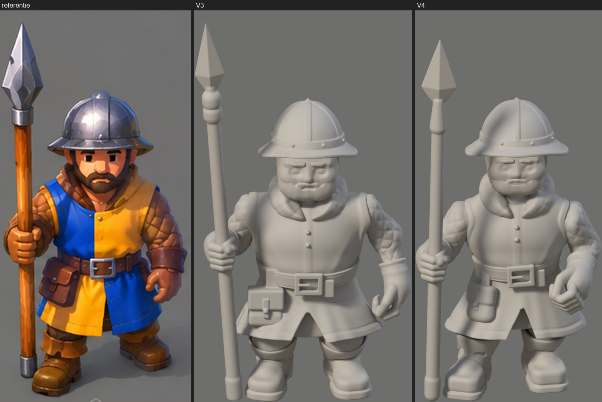

# V4: kwaliteitsrapport

**Geen artistieke goedkeuring: die geeft Marcel.** Technische tests zeggen niets over de kwaliteit.

## De conclusie

V4 staat zichtbaar dichter bij de referentie dan V3, vooral in houding, armen, breedte en rok. **Niet alle acceptatiecriteria zijn gehaald.** Hieronder per stuk.

## Acceptatiecriteria

| # | Criterium | Uitkomst | Bewijs en voorbehoud |
|---|---|---|---|
| 1 | Silhouet dichter bij de referentie | **Deels** | Z: overlap 0,742 naar 0,786; N: 0,685 naar 0,731 (gecorrigeerd op 31 okt, zie `V4-PROPORTIES.md`). Hele breedte 0,685 naar 0,612, plaat 0,601 |
| 2 | Houding overtuigender, minder symmetrisch | **Ja** | Gewicht op één been, armen verschillend; oordeel aan Marcel |
| 3 | Hoofd behoudt zijn verhouding | **Ja** | Zelfde schaal als V3; helm tot baard 0,354, plaat 0,334 |
| 4 | Schouders en armen minder opgeblazen | **Ja op beeld; de meting spreekt deels tegen** | Taps, geen pof. Schouders nu 11 % te smal in Z, bovenarm 19 % te smal op de meetplek |
| 5 | Tabberd beweegt natuurlijker | **Deels** | Veel minder doorsteek; een holle rok; in W nog wat stijf |
| 6 | Belangrijkste zichtbare clipping opgelost | **Grotendeels** | Broek door rok: 1359 naar 216. Zoom raakt de omslag nog; speer door mouw in de steektest |
| 7 | Voeten overtuigend op de grond | **In rust ja, in de loop niet** | Rust -3 mm. Lopen, ongewijzigd: -1,8 tot +1,9 cm |
| 8 | Speer correct vastgehouden | **Ja** | 0,0 mm; vingers om de schacht; een hand |
| 9 | Acht richtingen consistent | **Ja, op de geometrie** | De verf van het gezicht is niet opnieuw beoordeeld |
| 10 | Bestaande animaties bruikbaar | **Lopen ja; rest niet te testen; overgang slechter** | Lopen 0 kanalen veranderd. Aanval en sterven bestaan niet op dit skelet. Staan naar lopen: speerpunt springt 0,137 m (was 0,074) |
| 11 | Op 80 pixels beter leesbaar | **Deels** | Stand, armen en ogen lezen beter; verschil kleiner dan op de grote plaat (`D-80px.png`) |
| 12 | Reproduceerbaar | **Ja, op deze pc** | Alles uit `keten_v4.sh`, geen handwerk |

## Verbeteringen, regressies en open punten

**Beter dan V3:** houding, breedte, riem, zoom, rok, helmrand, buidel, laarzen, hand en pols, speer, broek door rok.

**Regressies:**
- Overgang staan naar lopen springt meer (0,137 tegen 0,074 m).
- Schouderbreedte en bovenarm wijken meer af op de meting.
- Gezicht iets smaller dan op de plaat (0,189 tegen 0,197).
- Cel, anker en stap in de JSON veranderen door de grotere schaal; het spel leest ze per houding.

**Open:**
- Geen aanval, geraakt en sterven in deze stijl. Die zijn nog de oude.
- Zolen in de loop niet precies op de grond.
- Voetafstand 18 % smaller dan op de plaat.
- V4 rekent 3,2 % meer pixels per meter dan de productie. Dat is niet erg zolang de andere eenheden nog niet in deze stijl zijn, maar leg het vast als er een tweede eenheid komt.
- GLB-export niet getest op V4. Niet nodig zolang rok-variant A geen nieuwe botten vraagt, maar wel vóór productie.
- Firefox en beeldtijd niet gemeten. De vellen zijn iets groter dan die van V3 (lopen 881 KB tegen 833 KB, staan 236 KB tegen 222 KB).

## Meshkwaliteit

Geen losse punten, dubbele punten of platte vlakken. Alles is gesloten; het verborgen lijf heeft 48 open randen, zoals in de productie. Niet-manifold randen komen in kleine aantallen voor waar twee vlakken raken; op beeld niet te zien.

| Onderdeel | Vlakken | Open randen | Niet-manifold | Los | Dubbel |
|---|---|---|---|---|---|
| baard | 23216 | 0 | 1 | 0 | 0 |
| buidel | 10066 | 0 | 18 | 0 | 0 |
| gambeson | 55124 | 0 | 3 | 0 | 0 |
| handschoenen | 42800 | 0 | 4 | 0 | 0 |
| helm | 104098 | 0 | 38 | 0 | 0 |
| hoofd | 50140 | 0 | 4 | 0 | 0 |
| hozen | 13418 | 0 | 0 | 0 | 0 |
| kap | 40562 | 0 | 74 | 0 | 0 |
| laarzen | 58020 | 0 | 9 | 0 | 0 |
| riem | 44868 | 0 | 4 | 0 | 0 |
| speer | 68788 | 0 | 0 | 0 | 0 |
| tabberd | 139478 | 0 | 6 | 0 | 0 |
| **samen, zonder lijf** | **650578** | | | | |

Dit is bronmateriaal voor sprites, geen realtime mesh.

## In het spel

Getest in Chromium op zoom 1 en 2, staan en lopen, tussen de andere figuren, zonder consolefouten. Alleen in de browser: het spel zelf is niet veranderd. `F-in-het-spel.png`, `F-in-het-spel-zoom1.png`.

## Beoordeling per onderdeel

**Mijn eigen, deels subjectieve oordeel op de beelden, geen meting**, op een schaal van 1 tot 10.

| Onderdeel | Cijfer | Waarneming |
|---|---|---|
| Silhouet | 7 | Compact en herkenbaar; breedte klopt nu; de stand is nog wat smaller |
| Anatomische geloofwaardigheid | 6 | Armen en stand kloppen; de knie onder de rok leest nog als een bal |
| Gezicht | 5 | Eenvoudiger en ogen te zien, maar in klei streng en ouder; de warmte van de plaat zit er niet in |
| Helm | 7 | Goede vorm en verhouding; de koepel is nog iets smal; de brede kam van de plaat is subtieler |
| Kleding | 6 | Tabberd en kraag kloppen; gewatteerde ruiten ondieper dan op de plaat |
| Tabberd | 7 | Schouderstuk, vier vlakken, hol; in beweging nog wat stijf |
| Handen en voeten | 6 | Hand en pols kloppen; laarzen blokkig en leesbaar; handschoen eenvoudiger dan op de plaat |
| Houding | 7 | Duidelijk asymmetrisch en stabiel, past bij de plaat; nog wat minder dynamisch |
| Herkenbaarheid op spelmaat | 7 | Leest goed tussen de andere figuren |
| Overeenkomst met de referentie | 6 | Dichterbij, maar nog geen schilderij: dat is ook de stap na de vorm |

## Controle productie

`figuur.py`, `vorm.py`, `skelet.py`, `beweging.py`, `materialen.py`, `render.py`, `vel.py`, `controle_model.py` en `bron/speerman.blend` zijn byte voor byte gelijk aan de back-up. Geen wijzigingen in `beelden/`, `tegels/` of `js/`. D8 en AI niet gedraaid, niets gedownload of geïnstalleerd, niets gecommit of gepusht.
