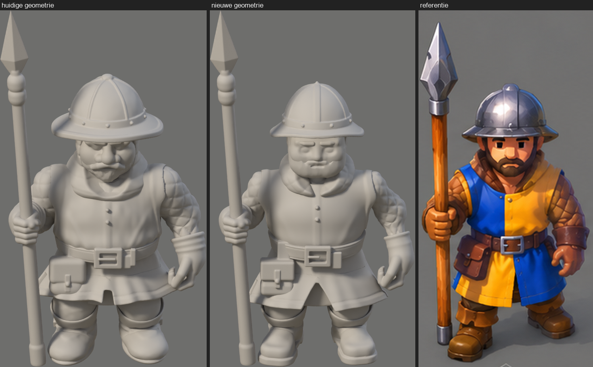
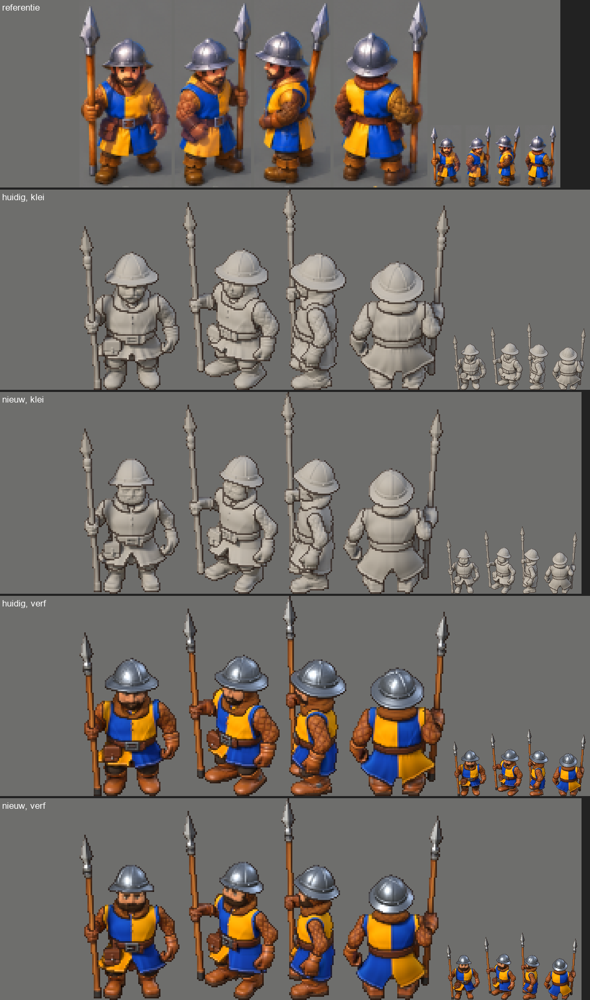

# De vormproef van de speerman

Vraag 192, 31 okt 2026, op Marcels opdracht "artistieke vormcorrectie". **Dit wacht op zijn beoordeling.** Er is geen D8 gedraaid, de productie is niet veranderd en er is niets gecommit. De variant staat in `gereedschap/blender/stijl/proef/vorm3.py`.

## De uitkomst

De vorm staat aantoonbaar dichter bij de referentie: 8 van de 11 maten zijn dichterbij, en dat is ook te zien (`bewijs/vormproef/vorm-naast-elkaar.png`). **De plaat is nog niet bereikt.** Op 80 pixels is de winst kleiner dan op de grote plaat. Drie maten werden niet beter, en de stand en de armen zijn niet veranderd: die horen bij de pose, en de opdracht was om de animaties te behouden.

## De analyse en wat er veranderde

| Onderdeel | Op de referentie | Huidig | Nieuw |
|---|---|---|---|
| Hoofd en lichaam | Helm tot baard 0,338 van de hoogte | 0,372, te groot | 0,357. Hoofd 9 % kleiner (`kop` 1,26 naar 1,15) |
| Gezicht | Breed, vlak, rechte wenkbrauwen, korte neus, volle baard | Bolle wangen, grote neus, kleine ogen, valt onder de rand | Grote platte vlakken, korte neus, rechte wenkbrauwen, volle baard. De ogen zijn nu te zien |
| Helm | Hoge koepel, smalle hangende rand, brede strip van voor naar achter | Brede platte rand met dikke rol, zes gelijke ribben | Smallere rand die meer hangt, dunne lip, één brede strip en twee smalle ribben, kantelt 11° naar achter |
| Schouders en armen | Bovenarm 0,094 | 0,110, bol | 0,090, geen bulten |
| Gambeson | Grote kussens, de mouw blijft één vorm | Vlakken met een dunne groef, bultige rand | Kussens lopen geleidelijk op; rustiger, maar minder diep dan op de plaat |
| Tabberd en kraag | Over de schouder, gestikte kraag met V, rechte lange rok, wijde split | Smalle banden, gladde rol als sjaal, korte gerimpelde rok | Tabberd over de schouder met dikke rand, gestikte kraag met V, rok 14 % langer en vlakker, wijde split voor en achter |
| Handschoenen | Rechte kap om de onderarm, grote hand | Trechter met ringen | Rechte strakke kap, smalle pols. Nog geen riempjes en nagels |
| Riem en buidel | Rechte gesp, hoekige buidel met klep | Gesp met dubbele balk, buidel als zeep | Eén pen in de gesp, hoekige buidel met klep, riempje en knoop |
| Laarzen | Blokkig, losse zool met hak, omslag met kepen | Rond als een ballon, geen zichtbare zool | Platte neus, zool met hak, rechte kepen, zonder band om de enkel |
| Stand | Wijd, één voet voor | Recht | **Niet veranderd**: dit is de pose |

## De maten

Als deel van de hoogte van helm tot zool, op richting Z en zonder de speer. De modellen komen uit de ID-beelden, de plaat is met het oog afgelezen (±1 %). **De Z op de plaat staat iets gedraaid, dus schouders en riem zijn daar smaller dan recht van voren.** Neem die twee als een richting, niet als een exact getal.

| Maat | Plaat | Huidig | Nieuw | |
|---|---|---|---|---|
| Helmrand | 0,350 | 0,384 | 0,330 | dichterbij, nu iets te smal |
| Koepel | 0,260 | 0,264 | 0,244 | **niet dichterbij** |
| Gezicht met haar | 0,230 | 0,191 | 0,201 | dichterbij, nog te smal |
| Helm tot baard | 0,338 | 0,372 | 0,357 | dichterbij, nog te groot |
| Schouders | 0,381 | 0,404 | 0,414 | **niet dichterbij** |
| Riem | 0,263 | 0,359 | 0,342 | dichterbij, nog te breed |
| Zoom | 0,410 | 0,361 | 0,385 | dichterbij |
| Riem tot zoom | 0,227 | 0,183 | 0,222 | dichterbij |
| Bovenarm | 0,094 | 0,110 | 0,090 | dichterbij |
| Laars | 0,209 | 0,233 | 0,219 | dichterbij |
| Hele breedte | 0,604 | 0,677 | 0,685 | **niet dichterbij** |

Schouders en hele breedte werden relatief groter doordat de figuur korter is, terwijl de armen op hun botten blijven. De linkerhand hangt op x = 0,335 m; op de plaat zo'n 0,29 m. Dat kan alleen met een andere pose.

Een eerste meting per rij (`afwijking`) gaf bij de zijkant en de rug een slechter getal. Die meting bleek niet bruikbaar: de speer telde mee, en de rijen vielen daardoor niet samen. Ik heb hem vervangen door deze meting per onderdeel, en de eerste uitkomst dus niet als bewijs gebruikt, ook niet de betere uitkomst op Z.

## Wat nog verschilt

- **Pose:** op de plaat staat hij wijder en dynamischer, met de armen dichter bij het lijf.
- **Gezicht:** nog smaller dan op de plaat, en in klei streng en ouder. De ogen komen pas met de verf echt.
- **Gambeson:** de kussens zijn kleiner en minder diep dan de grote ruiten op de plaat.
- **Handen:** de vuisten zijn kleiner, en de kap heeft nog geen riempjes en nagels.
- **Laarzen:** de plaat heeft een hoekigere neus en een dikkere, hogere omslag. Bij ons leest de omslag als een dunne ring.
- **Speer:** niet aangepakt. Op de plaat zijn de schacht en het blad dikker.
- **Tweede buidel:** de plaat heeft er aan elke kant één, wij één.

## Op 80 pixels

Slankere armen, langere rok, smallere helm en de ogen zijn te zien. De helm verschilt het duidelijkst. Details van de kraag en de laarzen zijn bijna niet te zien. De kolom "verf" gebruikt de verf en het licht van de productie, dus geen D8. De verfbeelden zijn alleen voor de leesbaarheid; ze zijn geen voorstel voor de kleur.

## De technische controle

| Controle | Uitkomst |
|---|---|
| Skelet | 26 botten, 0 verschillen |
| Animaties | Staan en lopen, 364 kanalen, 0 verschillen |
| Modelcontrole | 117 van 117, ook hand op de speer (< 2 mm) en voeten die niet glijden |
| Vellen | 42 van 42 |
| Acht richtingen | Gerenderd, zelfde camera: `vorm-acht-richtingen.png`, `vorm-acht-80px.png` |
| Hand op de speer | Zelfde contact als nu (744 tegen 744 driehoeken), `vorm-handen.png` |
| Anker, stap, fps | Gelijk |
| Cel | Staan gelijk (78×138). **Lopen 84×141 tegen 84×140: één pixel hoger** |
| Voetlijn | **Gelijk of 1 pixel verschil**, per richting (lopen 139 tot 152 tegen 139 tot 151; staan in Z 148 tegen 147) |
| Schaal | Gelijk in pixels per meter. **De figuur is 3,1 % korter** (1,354 tegen 1,398 m), dus zo'n 77,5 in plaats van 80 pixels |
| Productie | `figuur.py`, `vel.py`, `render.py`, `speerman.blend` en meer zijn byte voor byte gelijk aan de back-up. Niets in `beelden/`, `tegels/` of `js/` veranderd |

### Doorsteek

Driehoeken die elkaar snijden op de vervormde mesh, staan en 12 beelden lopen (`doorsteek-*.json`). Dit zegt alleen iets in vergelijking met het huidige model, want lagen die elkaar raken zijn niet altijd te zien.

| Paar | Huidig | Nieuw | |
|---|---|---|---|
| Handschoen door tabberd, staan | 359 | 0 | beter |
| Gambeson door tabberd, lopen, gemiddeld | 3448 | 2331 | beter |
| Kraag door tabberd, lopen, gemiddeld | 1456 | 1086 | beter |
| Tabberd door laars, lopen, gemiddeld | 1086 | 1269 | **slechter**: de langere rok |
| Tabberd door buidel, lopen, hoogste | 965 | 1052 | **slechter** |
| Kap door helm, baard door kap | 1895 en 800 | 2625 en 955 | **meer**, onder de helm en in de kraag; op de platen niet te zien |

### Wat ik zelf zag in de loop

Met het oog nagekeken op 6 van de 12 beelden in ZW, W en N, in klei (`vorm-loop.png`, `vorm-loop-rok.png`). Ik zag geen onderdeel dat door een ander steekt. Wel:

- **De langere rok zwaait als een stijf paneel**, en klapt in sommige beelden op bij de knie.
- **De split opzij is een zwarte keep.** Die zat er al, maar valt nu meer op.
- **Onder de rok lijkt de knie op een bal** met de omslag als dunne ring. Ook dat zat er al.
- **De dunnere onderarm plooit meer** in de loop.

Het verschil per beeld op 80 pixels bleef gelijk (lopen 13,16 tegen 12,98), maar de randpixels die wisselen stegen 5 % (207,8 tegen 218,3).

## Besluiten voor Marcel

1. **Is deze vorm goed genoeg om D8 opnieuw te draaien?** Dat kost zo'n 50 minuten (`textuur_b.py`, `keten_d.sh`, `keten_d8.sh`), en daarna is elke modelwijziging weer nieuw werk.
2. **Het kleinere hoofd:** ik week af van 32 % (nu 30,6 %, gemeten van hals tot kruin), omdat de plaat dat liet zien. De figuur wordt daardoor 3 % korter dan de rest. Zo laten, of de figuur iets groter zetten?
3. **Mag de staande pose veranderen?** Een wijdere stand met de armen dichter bij het lijf zou schouders en hele breedte het meest helpen, maar raakt de animatie. Daarom is het niet gedaan.

## Draaien

`bash gereedschap/blender/stijl/proef/keten_vorm.sh` doet alles in 15 minuten: bouwen, controles, klei, verf, vellen en platen. Hij schrijft alleen in `uit/stijl/vormproef/` en `docs/art/bewijs/vormproef/`. De variant vervangt in zijn eigen proces velden uit `figuur.py`; dat bestand zelf verandert niet. Klei is de `klei`-vlag van de bestaande `render.py`.

**Later gecorrigeerd:** de 0,23 voor het gezicht op de plaat was een schatting; op een raster gemeten is het 0,197 (`v4/V4-ANALYSE.md`). Het vervolg is vormproef V4: `v4/OVERDRACHT.md`.

De platen in `bewijs/vormproef/`: `vorm-naast-elkaar.png`, `vorm-zij-en-rug.png`, `vorm-80px.png`, `vorm-acht-richtingen.png`, `vorm-acht-80px.png`, `vorm-handen.png`, `vorm-loop.png`, `vorm-loop-rok.png`, `vorm-maten.json`.
